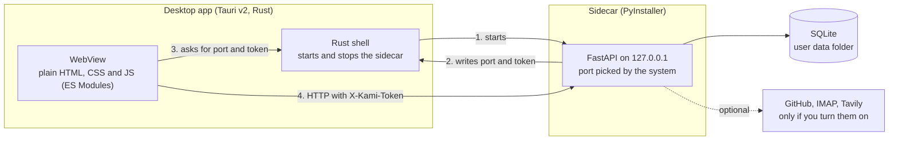

<div align="center">

# Kami

**A local-first personal productivity app that turns organizing your life into a game.**
Career, finances, studies and goals in one place, with your data on your own computer.

[](https://github.com/emanuel-frs/KAMI/actions/workflows/smoke-test.yml)
[](https://github.com/emanuel-frs/KAMI/releases/latest)


**[Português](./README.md)** ·
**[⬇ Download](https://github.com/emanuel-frs/KAMI/releases/latest)** ·
**[Install guide](./docs/INSTALACAO.en.md)** ·
**[Report a problem or give feedback](https://github.com/emanuel-frs/KAMI/issues/new/choose)**


---

</div>

## What it is and who it's for

My personal information was scattered across loose notes, spreadsheets, e-mails and memory, with no
consolidated view of career, finances, learning and goals. Kami brings it all into one app and uses a
simple idea to give you a reason to come back: every action you record (an expense logged, a study
module finished, a goal that moved forward) earns XP in one of five life attributes, levels up and
unlocks achievements.

The look is a tribute to old terminals: black, white, gray and a single, configurable accent color.

**Who it's for:** people who like local tools that need no account or subscription. The interface
speaks 10 languages (Portuguese, English, Spanish, French, Italian, German, Chinese, Japanese, Korean
and Hindi). **Who won't like it:** anyone who needs macOS, sync between devices or a phone app — none
of those exist.

A personal project, maintained by one person. Built for my own use and published as a portfolio piece.

| Core | Finances | Learning |
|---|---|---|
|  |  |  |

## Features

- **Core:** the five life attributes (Career, Finances, Learning, Organization and Goals), each with XP
  and a level, an overall player level, a filterable log of everything recorded, 50 automatic
  achievements (with tiers and a few secret ones), achievements you create yourself ("10 learning
  actions with 'english'") and a widget board you arrange however you like. Every action shows the XP
  earned right away; leveling up opens its own screen and achievements pop up in a corner notice.
- **Habit loop:** a day streak with a pixel-art flame that grows with it and shields that cover a blank
  day; three missions a day and one a week, drawn from what you can actually do right now; bonus XP for
  the first action of the day, for the streak and for tending to the most neglected attribute; and the
  radar warns you when an attribute has been idle for two weeks.
- **Progression:** raising your overall level unlocks titles (shown under your name) and terminal
  themes (phosphor, CRT and amber); your class (Scholar, Merchant, Artisan, Strategist, Archivist or
  Polymath) comes from your strongest attribute; and every month opens an ASCII recap of the month that
  ended, exportable as `.txt`.
- **Old-terminal feel:** text that types itself, rolling numbers, cards that switch on like a CRT,
  phosphor glow and a pixel-art cursor, plus 8-bit beeps generated on the fly for progress, clicks and
  notices. Effects (full, subtle or off) and sounds (per group, with volume) are set in settings ›
  appearance.
- **Finances and Wallet:** recurring income with business-day calculation (holidays of the country you
  pick), fixed bills, debts, subscriptions, installment purchases, credit cards, transactions by category
  and a monthly view compared with the previous month. A mistyped transaction can be fixed or deleted,
  and the balance and XP follow; paying off a debt can record the payment on an account.
- **Learning:** study tracks with milestones, automatic progress, a reorderable roadmap and an activity
  heatmap.
- **Personal goals:** types such as financial, health, reading, habit, learning and academic, with a
  weight that multiplies the XP. A financial goal can draw from a real Wallet account.
- **Organization:** notes with a visual editor (saved as markdown, with tags, colors, links to goals,
  tracks, events and positions, and notes locked by the PIN), the quick-capture inbox, categorized
  links, the status of your GitHub repositories, IMAP e-mail read as clean text (no third-party HTML,
  with a link to open it in your webmail) and an optional web search.
- **Capture and search:** `Alt+Q` jots anything down from any screen — `$ 32.90 pharmacy yesterday`
  becomes an expense, `# idea` a note, `! friday 2pm meeting` an event, `@ tomorrow 9am call the bank` a
  reminder, and the rest goes to the inbox — dates and times in the app's language; `Ctrl+K` searches
  everything (ignoring accents) and runs commands.
- **Habits:** its own screen (`Alt+9`) with daily habits, on fixed days or "x times a week", a grid of
  the last 12 weeks, streak and record per habit, pause and archive; checking one off gives XP and
  counts toward missions and the overall streak.
- **Reminders:** with date, time and repetition, linked to notes, bills, goals or habits, they notify
  inside the app and through the system notification (with "snooze"); due-date notices grouped at a time
  you choose. Optional: keep Kami in the tray when closed and start it with the system.
- **Career and Calendar:** a timeline of positions, education and salary history; a monthly calendar
  that brings together bills, debts, installments, goals, your own events and reminders.
- **Language, currency and country:** 10 languages (the system's on first launch, or the one chosen in
  settings › appearance), with the currency (format only, nothing is converted) and the country whose
  holidays count for business days chosen there too. Dates in the language's format or the one you
  prefer. The translations were made with AI help and haven't been reviewed by native speakers —
  corrections are welcome ([docs/TRADUCAO.md](./docs/TRADUCAO.md), in Portuguese).
- **Profile:** an ASCII avatar generated inside the app from a photo; only the text is saved, never the
  photo.
- **Reliability:** when something goes wrong a notice shows a code that is also in the log; if the
  backend crashes, the app notices and restarts it on its own, without closing; before upgrading the
  database to a new version, Kami keeps a copy and goes back to it if the upgrade fails; a copy of the
  database is made automatically every week and before importing or erasing everything, with "restore"
  in settings › backup (and an optional extra folder, such as a USB drive); and settings › about can
  copy a diagnostic report, with no personal data, to report a problem.
- **Screens that arrange themselves:** widgets snap into aligned rows, at any window size and with any
  amount of data, and each screen has a default layout built to fit (with "reset layout"). A widget you
  remove and add back returns to its place. Optional: the app icon in the accent color.
- **Security:** an optional PIN to open the app (with a recovery code and an inactivity lock), backups
  exported with a password, and saved passwords protected by a key in the system keyring. Details and
  limits in [SECURITY.md](./SECURITY.md).

Kami **does not use artificial intelligence** today. The "kami assistant" in the sidebar is marked
"soon" and doesn't do anything yet.

## Install

Download the installer from the [Releases page](https://github.com/emanuel-frs/KAMI/releases/latest)
and check it against the `SHA256SUMS` published with it. Full details, uninstalling and where your data
lives are in [docs/INSTALACAO.en.md](./docs/INSTALACAO.en.md).

| System | How |
|---|---|
| **Windows (64-bit)** | Download `kami-<version>-windows-x64-setup.exe` and run it. It installs for your user only, without asking for administrator rights. See the warning below. |
| **Debian, Ubuntu and derivatives** | `.deb` from the Release, or `sh scripts/install.sh` |
| **Fedora, RHEL and derivatives** | `.rpm` from the Release, or `sh scripts/install.sh` |
| **Arch and derivatives** | `PKGBUILD` from the Release (uses `makepkg`), or `sh scripts/install.sh` |
| **Other distributions** | `.AppImage` |
| **macOS** | Not supported yet |

### ⚠ The Windows installer isn't signed

Code signing for Windows costs money and Kami is a personal project, so the installer **isn't signed**.
In practice, SmartScreen or Defender may show "unknown publisher" or even warn that the file may be
malicious. That's common for new, unsigned programs, and this one also bundles a Python backend packaged
with PyInstaller, a format antivirus tools sometimes flag by mistake. **The warning doesn't prove the
file is safe, nor that it's dangerous.** Check where it came from before trusting it:

1. download it only from this repository's Releases page;
2. compare the hash with the one in `SHA256SUMS` (`Get-FileHash <file> -Algorithm SHA256`);
3. if you like, upload the file to VirusTotal;
4. the code is here and the installer is built by the public
   [`release.yml`](./.github/workflows/release.yml) workflow.

Step by step for SmartScreen, Defender and Smart App Control in
[docs/INSTALACAO.en.md](./docs/INSTALACAO.en.md#unsigned-windows-installer).

**Other limitations:** in-app updating (it only notifies; it installs when you ask) works for the Windows
installer, the AppImage and the `.rpm` (it asks for your system password) — `.deb` and AUR update
through the package manager. On Linux, Chinese, Japanese, Korean and Hindi need the Noto fonts (the
packages recommend them; the app warns if they're missing).

## Privacy: what leaves your computer

Your data lives in a local SQLite database. The app only goes online when you turn on an integration,
and to check for a new version (you can turn that off). There's no telemetry and no user account.

| Destination | When | What is sent |
|---|---|---|
| `api.github.com` | only if you add a repository or token | repository names and the token (in a header) |
| Your e-mail provider (IMAP) | only if you add an account | user and app password, over SSL |
| `api.tavily.com` | only if you add a search key | your searches and the key |
| `duckduckgo.com` | only when you click "open search" | the search, opened in your browser |
| `github.com` (Kami Releases) | on launch and once a day, with "check for updates" on (default; turn it off in settings › about) | only the request for the versions file (`latest.json`), nothing of yours; and the download of the new version, if you ask to "update now" |
| Microsoft (Windows) | only during install, if WebView2 is missing | runtime download |

App passwords and tokens are encrypted in the database, with the key in the system keyring (Credential
Manager on Windows, Secret Service on Linux), not in the data folder. That doesn't protect against
another program running as your user; [SECURITY.md](./SECURITY.md) describes what Kami protects and what
it doesn't.

## How it works inside



The frontend is plain HTML, CSS and JavaScript with ES modules and no bundler. The backend is FastAPI
with SQLite and becomes a single executable with PyInstaller, which Tauri bundles as a *sidecar*. On
every run the sidecar picks a free port on `127.0.0.1` and generates a random token; only the app, which
reads those two values from files in the data folder, can use the API.

## Technical decisions and what I learned

**"Works on my machine" isn't "works on someone else's machine".** The first Windows installer opened
the app, but the bundled backend died silently: with no console, PyInstaller leaves `stdout` and
`stderr` null and uvicorn crashed while setting up logging. On top of that, the port was published
*before* the server was up. The fix was writing logs to a file, publishing the port only after startup,
showing the failure reason on screen with the log path, and installing the app on clean Windows,
Debian, Fedora and Arch machines on every push, through CI.

**An API on `localhost` isn't safe just because of that.** The backend listens only on `127.0.0.1`,
but CORS was open and the API has routes like the full data export. Any page open in the browser could
scan local ports and use them. I tried restricting by request origin and that broke the app, because
Tauri's real origin wasn't the documented one. The solution was not depending on the origin: a
per-run session token that a web page can't obtain. The sidecar tests on Linux check that the API
answers `401` without it.

**Closing the app has to close everything.** The backend is a one-file PyInstaller executable: a
bootloader that runs Python in a child process. On Linux, closing the app killed only the bootloader,
and the real backend stayed running orphaned every time. It only showed up testing the real app,
counting processes after closing the window. Now the app ends the whole tree, and the backend also exits
on its own if the app disappears without notice.

**Privacy promises have to match the code.** While reviewing, I found the app still asked a Google
service for each saved link's icon. I replaced it with a local initial, and the table above describes
only what really leaves the machine.

**No framework or bundler in the frontend.** It was a choice for simplicity and for learning the
platform, and it has a cost: some files got big (see the roadmap).

## Known issues and roadmap

No dates. Up to **2.0** (the version where Kami goes on pause, with no new features for a while), the
plan is:

- ~~**Foundation:**~~ done in 1.14: updates announced by the app itself (it installs only when you
  want), automatic backups (including to a second folder, like a USB drive), uninstalling that leaves
  nothing behind, automated tests covering every screen, and big files split up.
- ~~**Languages:**~~ done in 1.15: Portuguese, English, Spanish, French, Italian, German, Chinese,
  Japanese, Korean and Hindi, with your choice of currency and holiday country.
- **AI assistant (optional, off by default):** chat, actions always with a preview and confirmation,
  notices, and local AI running on your computer. No key ships with the app.
- **Encrypted database on disk**, optional.

Left out, at least until 2.0:

- **Windows:** code signing. The SmartScreen warning keeps showing up, because the free option for open
  source doesn't apply to the current license (see [SECURITY.md](./SECURITY.md#instaladores)). CI
  validates installation and the backend, but not each PC's antivirus behavior.
- **macOS, phones and sync between devices.**
- **Link icons** stored locally, **PyInstaller in folder mode** (fewer false positives) and publishing
  to the AUR and other repositories. See [docs/ROADMAP-INSTALACAO.md](./docs/ROADMAP-INSTALACAO.md) (in
  Portuguese).

## License and contributing

The code is **visible, but not open source**. You may read the code, install and use Kami for personal
purposes, but you may not redistribute it, publish copies as another product or use it commercially
without permission. Full text in [LICENSE](./LICENSE).

Feedback is welcome: [open an issue](https://github.com/emanuel-frs/KAMI/issues/new/choose) telling what
worked, what got stuck and on which system. Pull requests may be declined, and the [LICENSE](./LICENSE)
explains what happens to contributions. Translation fixes: see [docs/TRADUCAO.md](./docs/TRADUCAO.md).
Security issues: [SECURITY.md](./SECURITY.md).

## For developers

<details>
<summary>Running from source, tests and build</summary>

### Requirements

- Python 3.14 (`.python-version`; it's what CI uses and what ships inside the packaged backend)
- Node.js 24 (`.nvmrc`; only for the frontend tests)
- Rust at the version in `rust-toolchain.toml` (`rustup` installs it on its own) and the Tauri CLI
  (`cargo install tauri-cli --version "^2" --locked`), only for desktop mode
- Tauri system dependencies on Linux: see [tauri.app/start/prerequisites](https://tauri.app/start/prerequisites/)

Coming back to the project after a long time (versions, CI runners, dependencies, shipping a fix):
[docs/MANUTENCAO.md](./docs/MANUTENCAO.md) (in Portuguese).

### Backend

```bash
cd backend
python3 -m venv .venv
source .venv/bin/activate
pip install -r requirements.txt
uvicorn app.main:app --reload --port 8000
```

Creates `backend/kami.db` on the first run. Interactive docs at `http://127.0.0.1:8000/docs`. In this
mode there's no session token; it only exists in the packaged backend.

### Frontend

Desktop, with the backend running (`KAMI_DEV_NO_SIDECAR=1` skips starting the packaged sidecar):

```bash
cd src-tauri
KAMI_DEV_NO_SIDECAR=1 cargo tauri dev
```

Web, serving the ES modules (don't open the file directly):

```bash
cd frontend
python3 -m http.server 5500
```

Note: `cargo tauri dev` without that variable uses the sidecar binary already in `src-tauri/binaries/`.
If it's old, the app shows an error on startup. Rebuild it with `./build.sh`.

### Demo mode (fake data)

To record screens or test without touching your data:

```bash
cd backend
KAMI_DATA_DIR=/tmp/kami-demo uvicorn app.main:app --port 8000

# in another terminal, at the repository root
python3 scripts/seed_demo.py
```

The seed refuses to run on an instance that already has data. E-mail and GitHub stay empty in the demo,
because they depend on credentials. The demo data is in Portuguese.

### Tests

```bash
cd backend && pytest     # backend
npm install && npm test  # frontend (Node's built-in runner)
```

CI runs both suites on Linux and Windows on every PR.

**End-to-end test** (`tests/e2e/kami-e2e.mjs`): opens the built app with fake data, goes through the 9
screens at 3 window sizes and takes screenshots. It also records an action through the UI and walks,
with a real keyboard, through quick capture (`Alt+Q`, including a reminder that has to fire), the
palette (`Ctrl+K`), a note created, edited, locked and unlocked, the date format, the automatic copy
with restore, the PIN (turns it on, reopens the app, unlocks, turns it off), the tray with the second
instance and starting with the system. It kills the backend to check it comes back on its own and checks
that the log ended with no errors. In CI it runs on PRs to `main`, on `release/**` and on manual
dispatch, and the screenshots become workflow artifacts. To run it on Linux you need `WebKitWebDriver`
(package `webkit2gtk-driver`/`webkit2gtk4.1`) and `tauri-driver` (`cargo install tauri-driver
--locked`). It can run with your own Kami open: the test app uses a throwaway home folder, doesn't touch
the password keyring and doesn't talk to the real instance. It takes about 4 minutes;
`KAMI_E2E_RAPIDO=1` uses a single window size.

```bash
./scripts/build_sidecar.sh && (cd src-tauri && cargo tauri build --debug --no-bundle)
KAMI_E2E_APP=src-tauri/target/debug/kami KAMI_E2E_PYTHON=backend/.venv/bin/python node tests/e2e/kami-e2e.mjs
```

On GNOME you can run it with no window on screen, on a virtual monitor:

```bash
mutter --headless --wayland --no-x11 --wayland-display=kami-e2e --virtual-monitor 2000x1200 &
WAYLAND_DISPLAY=kami-e2e KAMI_E2E_APP=src-tauri/target/debug/kami KAMI_E2E_PYTHON=backend/.venv/bin/python node tests/e2e/kami-e2e.mjs
```

### Production build

```bash
cd backend && source .venv/bin/activate && pip install pyinstaller
./build.sh               # at the root: sidecar + installers in src-tauri/target/release/bundle/
```

On Windows the build has to run on a Windows machine (no cross-compiling) with Python, Rust, the Tauri
CLI and Git Bash. The version lives in `VERSION`; use `scripts/bump-version.sh` instead of editing it by
hand.

### Publishing a release

The version lives in `VERSION`. The [`release.yml`](./.github/workflows/release.yml) workflow builds the
Windows and Linux installers, publishes the checksums and creates the GitHub Release when it receives a
`v*.*.*` tag.

### Layout

```
backend/      FastAPI, SQLite, tests and the sidecar entrypoint (run_server.py)
frontend/     plain HTML, CSS and JS: pages/, widgets/, modals/, api/, i18n/ (the 10 dictionaries)
src-tauri/    desktop shell (Rust, Tauri v2)
scripts/      install, version, demo seed and CI tests
docs/         install guide, translation guide, roadmap and download page
```

</details>

---

<div align="center">

Made by **Emanuel** ([@emanuel-frs](https://github.com/emanuel-frs)) · ([LinkedIn](https://www.linkedin.com/in/emanuel-f-2565181b6/))

</div>
